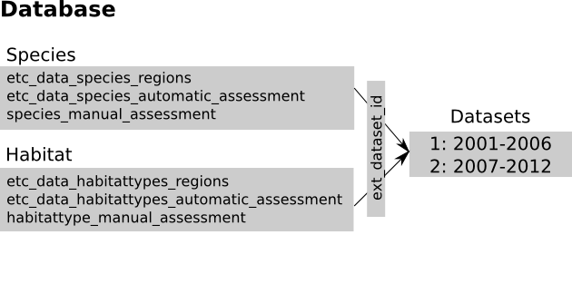

Database
========

This page describes the database structure. We're using the term *Dataset* to
describe a set of data for a given reporting period (such as 2001-2006). We
refer the table structure as *Schema*.

   The Database

Structure
---------
The tables can be classified *by content* in:

#. Initial content tables (ETC/BD member states data - ``*_regions``,
   Automatic Assessments - ``*_automatic_assessments``)
#. Dictionary tables (Country codes, Method details, Trend details, ...
   ``*_dic_*``)
#. User contributed content (Conclusions - ``*_manual_assessments``,
   Comments on conclusions - ``*_comments``, Datasheet info,
   Audit trail - ``*wiki*``)
#. Application specific (Registered Users, Configuration, Dataset information).

Each of the tables in the first three categories contain a column named
`ext_dataset_id` linking to the dataset the record belongs to.

Backend
-------

We're using a Postgres database, configured through the ``DB_*`` environment
variables (``DB_HOST``, ``DB_NAME``, ``DB_USER``, ``DB_PASS``). A second database
on the same server (``BIND_NAME``) is used by the factsheets. Each table has a
corresponding class in ``models``, and the rows in the table are instances of that
class.

Management
----------

.. WARNING::
  The ``flask dataset`` command has not been used in a long time.
  Please use instead `generate_new_period` and `import_new_data`.

The ``flask dataset`` command can be used to manage the datasets. The following
commands are available:

* ``dataset ls`` - list all datasets in the application database
* ``dataset rm`` - remove a dataset (and all entries related to that dataset
  in various tables)

The newer commands used in generating a new reporting period:

* ``python -m flask generate_new_period run --schema 2024 --name 2019-2024``

Generates a new dataset entry using the given schema and name and fills in the dic/etc data required
using information of the previous reporting period.

* ``python -m flask import_new_data run -m Model -f file_path [-s sheet]``

Receives a model and a file path and imports the data from the file (expects an Excel document;
the sheet name or index is optional). The available models are ``EtcDataSpeciesRegion``,
``EtcDataHabitattypeRegion``, ``EtcDataSpeciesAutomaticAssessment``,
``EtcDataHabitattypeAutomaticAssessment``, ``SpeciesManualAssessment`` and
``HabitattypesManualAssessment``.

Although improvements can be made, those two commands are enough to generate a new reporting period and import
the information for the Member state reports/Automatic assessments and Manual assessments.

Other available commands (``python -m flask --help`` lists them all; most of them
are run with the ``run`` subcommand, e.g. ``python -m flask loaddata run``):

* ``user`` / ``role`` - manage users and roles
* ``factsheet species`` / ``factsheet habitat`` - generate the factsheet PDF file
  for a species/habitat
* ``generate_new_factsheets_urls``, ``check_new_factsheets_urls``,
  ``set_new_factsheets_urls`` - manage the remote factsheets URLs
* ``pre_fill_wiki_changes_species``, ``pre_fill_wiki_changes_habitat`` - pre-fill
  the data sheet info of a reporting period from a CSV file (``-d dataset_id -f file``)
* ``dumpdata`` / ``loaddata`` - export/import data as fixtures
* ``fix_manual`` (2013-2018 manual assessments values) and ``import_greece``
  (2007-2012bis data) - one-off fixes used for previous reporting periods
