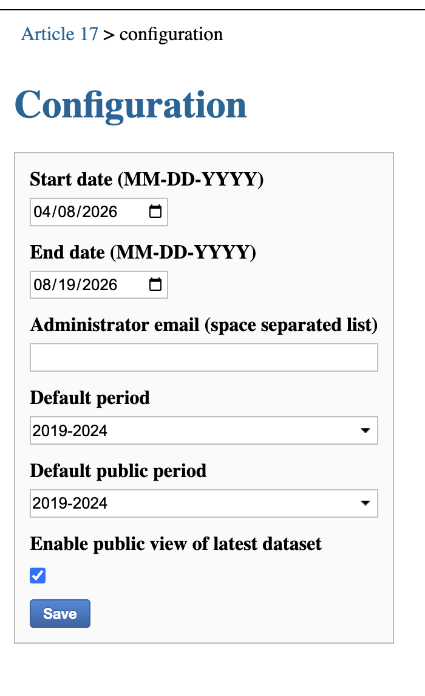
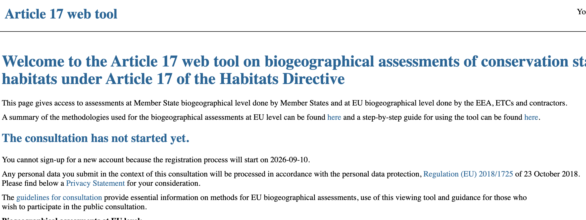
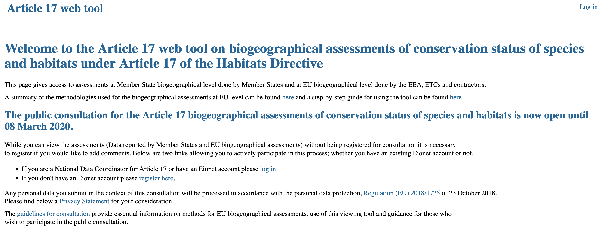
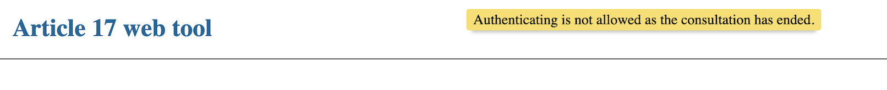

************
Consultation
************

The administrators have access to a Configuration panel for the application.

The user can set the following:

* **Start date** - The day the consultation should start
* **End date** - The day the consultation should end
* **Administrator email** - Administrator emails for notifications (space separated list)
* **Default period** - This should be the latest period (is currently set to 2019-2024)
* **Default public period** - The period shown by default to unauthenticated users outside
  the consultation. This allows assessors to modify the assessments, but still not display
  the period 2019-2024 to the public. As such, this is set to period 2013-2018.
* **Enable public view of latest dataset** - Combined with the default public period setting,
  this enables or disables the view rights of unauthenticated users on the latest period.

   *Config panel*

Reporting period settings
-------------------------

Each reporting period (dataset) can be edited by administrators from the
*Dataset Admin* section, where the following options are available:

* **Is readonly** - Nothing can be added, edited or commented on a read-only period,
  and all its information is visible to everyone. All previous reporting periods
  should be marked as read-only.
* **Latest** - Marks the latest reporting period, for which the `Show Assessment`
  user setting applies.
* **Public can view automatic assessments** / **Public can view manual assessments** -
  Whether unauthenticated users can see the assessments after the consultation ended
  (and before the period is marked as read-only).

Consultation timeline
---------------------

The set start day and end date have an effect on the application behaviour:

1. **Before the consultation starts (start day is in the future):**

   *Before consultation*

Stakeholders and unauthenticated users cannot see the manual assessments, the automatic
assessments and the audit trails of the reporting periods that are not read-only.

Stakeholders cannot add, edit or delete assessments, or add comments. Assessors cannot add
assessments, but can edit them. Administrators can add and edit assessments.

Users cannot self-register using an EIONET account from the registration page. However,
an EIONET user logging in for the first time is still registered automatically, and the
local account registration is not restricted by the consultation dates.

2. **During the consultation (start day is in the past and end date is in the future):**

   *During consultation*

Everybody can see the assessments, and users are able to self-register.

Stakeholders can add assessments, edit or delete their own assessments and comment.
Assessors can no longer edit or delete assessments or add comments until the consultation ends.

3. **After the consultation ended (end date is in the past):**

   *Stakeholders can no longer login after consultation*

Please note that there is no configured message for the home page when the consultation is over and the during message
needs to be cleared manually by removing the dates.

Stakeholder users can no longer log in. Unauthenticated users can see the assessments only if this is enabled for the
reporting period (see *Reporting period settings* above).

Assessor users can edit assessments again, and Administrators can still add assessments, until the reporting
period is marked as read-only. Audit trails and data sheet info can be edited by Assessors and Administrators
at any time, until the reporting period is marked as read-only.
